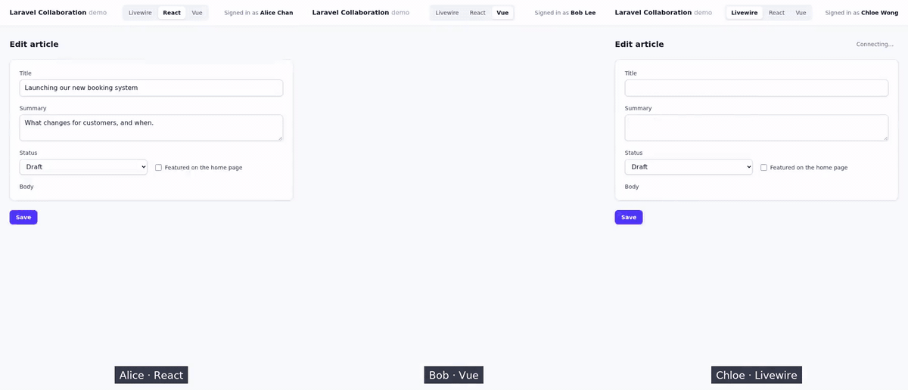
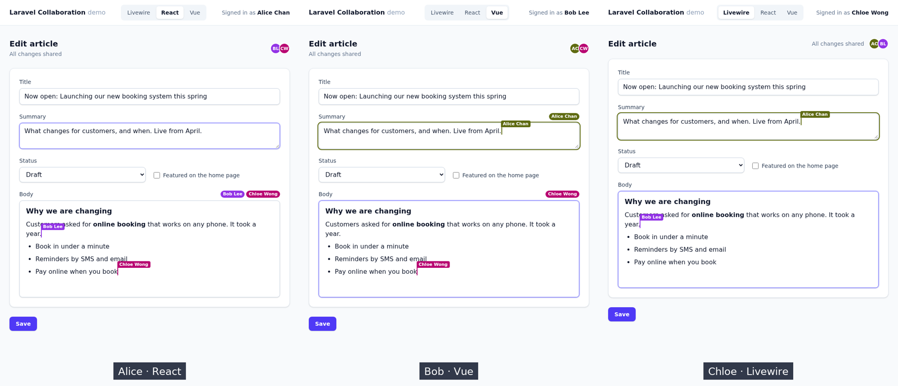
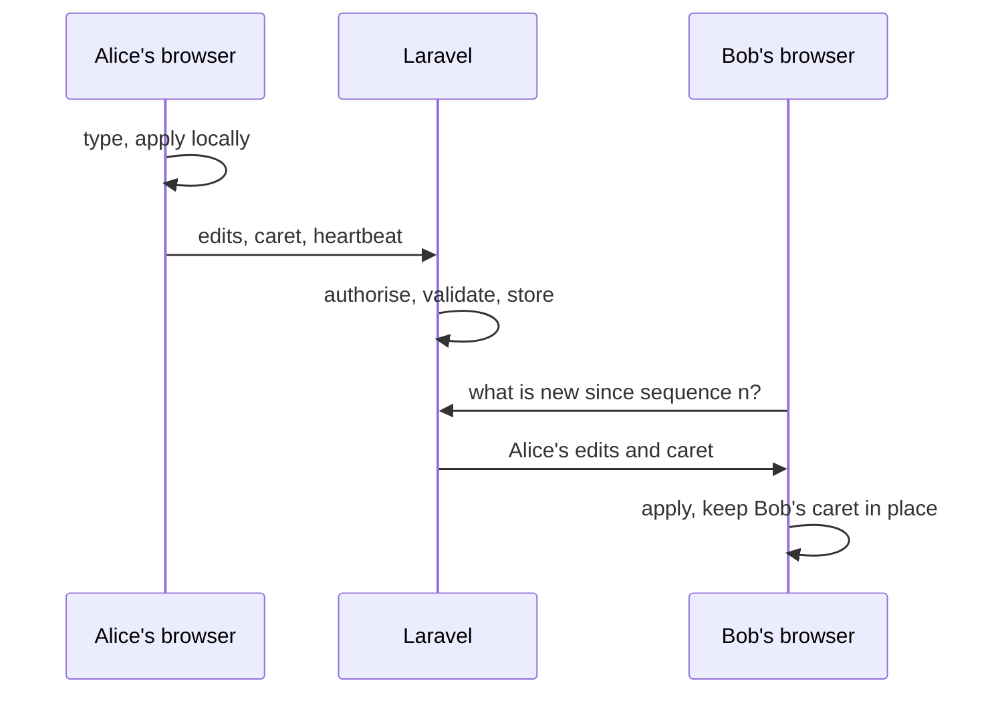

# Laravel Collaboration

Google Docs-style editing for any Laravel app. People editing the same record see each other, see each other's carets, and type into the same fields at the same time. Saving keeps everybody's work.

It works with **Livewire**, **Inertia + React** and **Inertia + Vue**, and with **TipTap** for rich text. It runs over plain HTTP, so you don't need a WebSocket server. Laravel Reverb makes it faster if you have one.



<sub>Alice in React, Bob in Vue and Chloe in Livewire, editing one article. Recorded from the [demo](#run-the-demo). [Watch as MP4](docs/media/demo.mp4).</sub>

## What you get

- **Live fields.** Text merges character by character, rich text keeps its formatting, and selects and checkboxes take the latest choice.
- **Presence.** Faces of everybody on the record, who is in which field, and their carets and selections.
- **Saves that lose nothing.** Whoever saves, the record gets everybody's edits, including keystrokes that hadn't synced yet.
- **Your authorisation.** People join through your policies, and every sync checks again.
- **No new infrastructure.** Your database and cache by default. Optionally Redis for presence and Reverb for pushes.

## Installation

```bash
composer require solutionforest/laravel-collaboration
php artisan migrate
```

The repository is private for now, so add it to your app's `composer.json` first:

```json
"repositories": [
    { "type": "vcs", "url": "git@github.com:solutionforest/laravel-collaboration.git" }
]
```

Inertia apps also install the browser side from the vendor folder:

```bash
npm install ./vendor/solutionforest/laravel-collaboration
```

Livewire apps need nothing else. The package serves its own script.

## Quick start

### 1. Say which fields people edit together

```php
use SolutionForest\Collaboration\Concerns\Collaborative;

class Post extends Model
{
    use Collaborative;

    protected array $collaborative = [
        'title',                // text, merged by character
        'summary',
        'body' => 'rich',       // TipTap, kept as HTML or JSON, like the column
        'status' => 'value',    // select, checkbox, radio: the latest choice wins
    ];
}
```

People join a record's room when your `PostPolicy` allows `update`, or `view` for a read-only room.

### 2. Use it from your stack

<details open>
<summary><b>Livewire</b></summary>

```php
use SolutionForest\Collaboration\Livewire\WithCollaboration;
use SolutionForest\Collaboration\Room;

class EditPost extends Component
{
    use WithCollaboration;

    public Post $post;
    public string $title = '';
    public string $status = '';

    public function room(): Room
    {
        return $this->post->collaboration();
    }

    public function save(): void
    {
        $this->saveCollaboratively(fn (array $values) => $this->post->update($values));
    }
}
```

```blade
<form wire:submit="save">
    <x-collaboration::room :room="$this->collaborationRoom()" />

    <input wire:model="title">
    <select wire:model="status">...</select>
</form>
```

That is all: inputs with `wire:model` on a room field become collaborative. For a rich text field, see [Rich text](#rich-text).

</details>

<details>
<summary><b>Inertia + React</b></summary>

```php
public function edit(Post $post)
{
    return Inertia::render('Posts/Edit', [
        'post' => $post,
        'collaboration' => $post->collaboration(),
    ]);
}

public function update(Request $request, Post $post)
{
    $post->collaboration()->save($request->validate([...]), fn (array $values) => $post->update($values));

    return back();
}
```

```jsx
import { Avatars, useCollaborativeForm } from '@solutionforest/laravel-collaboration/react'
import { CollaborativeEditor } from '@solutionforest/laravel-collaboration/react/editor'

export default function Edit({ post, collaboration }) {
    const form = useCollaborativeForm(collaboration, { title: post.title, body: post.body, status: post.status })

    return (
        <form onSubmit={(event) => { event.preventDefault(); form.put(`/posts/${post.id}`) }}>
            <Avatars form={form} />

            <input {...form.field('title')} />
            <select {...form.field('status')}>...</select>
            <CollaborativeEditor form={form} field="body" />

            <button>Save</button>
        </form>
    )
}
```

`useCollaborativeForm()` is Inertia's `useForm()` with collaboration added. Everything else (`errors`, `processing`, `put()`) works as usual.

</details>

<details>
<summary><b>Inertia + Vue</b></summary>

The controller is the same as for React.

```vue
<script setup>
import { Avatars, useCollaborativeForm, vCollaborate } from '@solutionforest/laravel-collaboration/vue'
import { CollaborativeEditor } from '@solutionforest/laravel-collaboration/vue/editor'

const props = defineProps({ post: Object, collaboration: Object })

const form = useCollaborativeForm(() => props.collaboration, {
    title: props.post.title,
    body: props.post.body,
    status: props.post.status,
})
</script>

<template>
    <form @submit.prevent="form.put(`/posts/${post.id}`)">
        <Avatars :form="form" />

        <input v-model="form.title" v-collaborate:title="form">
        <select v-model="form.status" v-collaborate:status="form">...</select>
        <CollaborativeEditor :form="form" field="body" />

        <button>Save</button>
    </form>
</template>
```

</details>

| | Livewire | React | Vue |
| --- | --- | --- | --- |
| Join the room | `<x-collaboration::room>` | `useCollaborativeForm()` | `useCollaborativeForm()` |
| Text, select, checkbox | `wire:model` | `{...form.field('title')}` | `v-collaborate:title="form"` |
| Rich text | TipTap + `Collaborative` | `<CollaborativeEditor>` | `<CollaborativeEditor>` |
| Faces | built in | `<Avatars>` | `<Avatars>` |
| Who is in a field | carets | `<FieldPeople>` | `<FieldPeople>` |
| Sync status | built in | `<Status>` | `<Status>` |
| Save | `saveCollaboratively()` | `$room->save()` | `$room->save()` |



## Rich text

Rich text fields are edited with [TipTap](https://tiptap.dev). The React and Vue `<CollaborativeEditor>` come with StarterKit; pass `extensions` to use your own. Anywhere else, add the `Collaborative` extension to your editor. On a Livewire page, `Collaboration.whenReady()` hands you the component's room:

```js
import { Editor } from '@tiptap/core'
import StarterKit from '@tiptap/starter-kit'
import { Collaborative } from '@solutionforest/laravel-collaboration/tiptap'

Collaboration.whenReady(element, (room) => new Editor({
    element,
    extensions: [StarterKit, Collaborative.configure({ room, field: 'body' })],
}))
```

The column decides the format: a `json` or `array` cast keeps TipTap's JSON, and anything else is saved as HTML. The [demo](demo/resources/js/livewire.js) has a complete Livewire editor.

## Saving

`save()` takes what the form submitted and a closure that writes to the database:

```php
$post->collaboration()->save($validated, fn (array $values) => $post->update($values));
```

Live fields come from the shared draft, which holds everybody's edits up to this moment, so a stale form can't overwrite someone else's typing. Other fields are saved as submitted. Everybody in the room then hears that the record was saved, and by whom.

## Describing a room in code

`$model->collaboration()` starts from the model's `$collaborative` fields. You can describe a room fully in code instead, without the trait:

```php
Collaboration::room($post)
    ->text('title', 'summary')
    ->rich('body')
    ->value('status', allowed: PostStatus::class)   // refuse values that are not cases
    ->labels(['body' => 'Article'])                  // "Alice is in Article"
    ->locale('fr')                                   // one draft per language
    ->viewing();                                     // watch without editing
```

## Configuration

Behaviour is set in code, usually in `AppServiceProvider::boot()`:

```php
use SolutionForest\Collaboration\Collaboration;

Collaboration::broadcast();                                    // push changes over Laravel Echo / Reverb
Collaboration::pollEvery(1000);                                // milliseconds, when nothing is pushed
Collaboration::nameUsersUsing(fn (User $user) => $user->display_name);
Collaboration::giveUsersAvatarsUsing(fn (User $user) => $user->avatar_url);
Collaboration::authorizeUsing(fn (User $user, Model $record, string $ability) => $user->can($ability, $record));
Collaboration::scopeRoomsUsing(fn (?Model $record) => tenant()?->id);   // keep tenants apart
Collaboration::audit();                                        // who changed which field, per minute
```

Deployment settings are in `config/collaboration.php` (`php artisan vendor:publish --tag=collaboration-config`): the database connection and table prefix, the cache store used for save locks, Redis presence, token lifetime and rate limits.

When roles change, call `Permissions::changed($post)` so open pages pick up the new permissions within a second.

### Pushing changes with Reverb

Polling works everywhere. With [Reverb](https://reverb.laravel.com) or Pusher set up in Laravel Echo, call `Collaboration::broadcast()`: edits then arrive as soon as they are stored, not at the next poll. The package registers its private channel, and only people in the room may listen.

## How it works

The shared draft is a CRDT, written twice, in PHP and in JavaScript. Both implementations replay the same recorded sessions in the tests, so they merge identically. Each page gets an encrypted token naming its user, record and fields. The browser sends its edits, caret and heartbeat in one request and gets back what it is missing. The server applies edits under a row lock and checks the user's access again on every request.



The engine is shared with [filament-collaboration](https://github.com/solutionforest/filament-collaboration), which builds its Filament integration on this package.

## Run the demo

The demo is one article you can edit from Livewire, React and Vue at the same time.

```bash
cd demo
composer install && npm install
cp .env.example .env && php artisan key:generate
touch database/database.sqlite && php artisan migrate --seed
npm run build && php artisan serve
```

Open <http://localhost:8000>, then pick a person and a stack. Use a private window for each extra person.

## Testing

```bash
composer test          # Pest: the merge engine, sync, saving, Livewire
npm test               # node:test: the merge engine and the browser client
npm run lint

cd demo && php artisan serve --port=8123 &
node tests/browser/smoke.mjs    # three real browsers, one per stack
node tests/browser/media.mjs    # re-records the screenshots and video in docs/media
```

## License

MIT. See [LICENSE](LICENSE).
