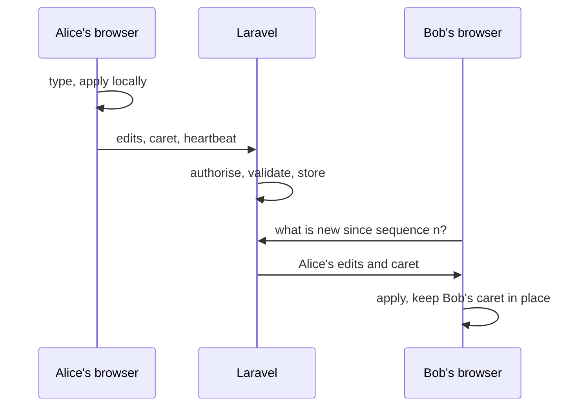

# Laravel Collaboration

Google Docs-style editing for any Laravel app. People editing the same record see each other, see each other's carets, and type into the same fields at the same time. Saving keeps everybody's work.

It works with **Livewire**, **Inertia + React** and **Inertia + Vue**, and with **TipTap** for rich text. It runs over plain HTTP, so you don't need a WebSocket server. Laravel Reverb makes it faster if you have one.


<sub>Alice in React, Bob in Vue and Chloe in Livewire, editing one article. Recorded from the [demo](#run-the-demo). [Watch as MP4](docs/media/demo.mp4).</sub>

**Contents:** [What you get](#what-you-get) · [Compared with filament-collaboration](#compared-with-filament-collaboration) · [Requirements](#requirements) · [Installation](#installation) · [Quick start](#quick-start) · [Rich text](#rich-text) · [Saving](#saving) · [Who may join](#who-may-join) · [Describing a room in code](#describing-a-room-in-code) · [Configuration](#configuration) · [Building an integration](#building-an-integration) · [How it works](#how-it-works) · [Troubleshooting](#troubleshooting) · [Run the demo](#run-the-demo) · [Testing](#testing)

## What you get

- **Live fields.** Text merges character by character, rich text keeps its formatting, and selects, checkboxes, checkbox groups, radios and dates take the latest choice.
- **Your own undo.** Ctrl+Z undoes your typing, never a colleague's.
- **Locks where merging makes no sense.** A locked field is read-only for everybody else while somebody is in it.
- **Presence.** Faces of everybody on the record, who is in which field, and their carets and selections.
- **Saves that lose nothing.** Whoever saves, the record gets everybody's edits, including keystrokes that hadn't synced yet.
- **Your authorisation.** People join through your policies, and every sync checks again.
- **No new infrastructure.** Your database and cache by default. Optionally Redis for presence and Reverb for pushes.

## Compared with filament-collaboration

Both packages share one engine. filament-collaboration is built on this package, which is why everything about drafts, merging and presence matches. These are the features each package's own UI offers:

| | filament-collaboration | This package |
| --- | --- | --- |
| Text, textarea: merged by character, carets | ✓ | ✓ |
| Rich text (TipTap): merged, carets | ✓ | ✓ |
| Select, checkbox, radio, toggle: latest wins | ✓ | ✓ |
| Checkbox groups and multiple selects | ✓ | ✓ |
| Each person's own undo | ✓ | ✓ |
| Lock a field while somebody is in it | ✓ | ✓ |
| Presence: faces, who is in which field, sync status | ✓ | ✓ |
| Saving everybody's edits, deleted-record notice, permission changes | ✓ | ✓ |
| Values limited to an enum, one draft per language | ✓ | ✓ |
| Repeaters and builders (lists of items) | ✓ | engine only, no binding yet |
| Comments and @mentions | ✓ | storage only, no UI yet |
| Version history and restoring a draft | ✓ | storage only, no UI yet |
| Choosing between versions when a save conflicts | ✓ | the latest save wins |
| Images uploaded into rich text while editing | ✓ | not yet |
| Who is on which record, in a table | ✓ | not yet |
| Follow a colleague from field to field | ✓ | not yet |

## Requirements

| | Supported |
| --- | --- |
| PHP | 8.3, 8.4 |
| Laravel | 12, 13 |
| Livewire | 4 |
| Inertia | 3, with React 19 or Vue 3.5 |
| Rich text | TipTap 3 |
| Database | MySQL / MariaDB, PostgreSQL, SQLite |
| Cache | Any store with atomic locks, shared by every app server: Redis, database, or file on a single server |
| Optional | Laravel Reverb or any Pusher-compatible broadcaster, for pushed changes. Redis, for presence across many servers. |

## Installation

The repository is private for now, so first tell Composer where it is, in your app's `composer.json`:

```json
"repositories": [
    { "type": "vcs", "url": "git@github.com:solutionforest/laravel-collaboration.git" }
]
```

Then install it and create its tables:

```bash
composer require solutionforest/laravel-collaboration
php artisan migrate
```

**Livewire apps** need nothing else: the package serves its own script.

**Inertia apps** also install the browser side, straight from the vendor folder:

```bash
npm install ./vendor/solutionforest/laravel-collaboration
```

It imports React, Vue, Inertia and TipTap from your app, so it adds nothing to your bundle that you don't already have.

## Quick start

### 1. Say which fields people edit together

```php
use SolutionForest\Collaboration\Concerns\Collaborative;
use SolutionForest\Collaboration\Enums\FieldKind;

class Post extends Model
{
    use Collaborative;

    protected array $collaborative = [
        'title',                            // text, merged by character
        'summary',
        'body' => FieldKind::RichText,      // TipTap, kept as HTML or JSON, like the column
        'status' => FieldKind::Value,       // select, radio: the latest choice wins
        'published_at',                     // cast to a date, so a value
        'channels',                         // cast to an array: a checkbox group
    ];
}
```

A name alone takes its kind from the model's casts: booleans, numbers, dates and enums are values, everything else is text. Kinds may also be written as strings (`'rich'`, `'value'`), but `FieldKind` cases can't be misspelt.

People join a record's room when your `PostPolicy` allows `update`, or `view` for a read-only room.

### 2. Use it from your stack

<details open>
<summary><b>Livewire</b></summary>

```php
use SolutionForest\Collaboration\Livewire\WithCollaboration;
use SolutionForest\Collaboration\Room;

class EditPost extends Component
{
    use WithCollaboration;

    public Post $post;
    public string $title = '';
    public string $status = '';

    public function room(): Room
    {
        return $this->post->collaboration();
    }

    public function save(): void
    {
        $this->saveCollaboratively();   // updates the post with everybody's edits
    }
}
```

```blade
<form wire:submit="save">
    <x-collaboration::room :room="$this->collaborationRoom()" />

    <input wire:model="title">
    <select wire:model="status">...</select>
</form>
```

That is all: inputs with `wire:model` on a room field become collaborative, whatever the modifier (`.live`, `.blur`). For a [Livewire form object](https://livewire.laravel.com/docs/forms), pass `state-path="form"` to the component and `statePath: 'form'` to `saveCollaboratively()`. For a rich text field, see [Rich text](#rich-text).

</details>

<details>
<summary><b>Inertia + React</b></summary>

```php
public function edit(Post $post)
{
    return Inertia::render('Posts/Edit', [
        'post' => $post,
        'collaboration' => $post->collaboration(),
    ]);
}

public function update(Request $request, Post $post)
{
    $post->collaboration()->update($request->validate([...]));

    return back();
}
```

```jsx
import { Avatars, useCollaborativeForm } from '@solutionforest/laravel-collaboration/react'
import { CollaborativeEditor } from '@solutionforest/laravel-collaboration/react/editor'

export default function Edit({ post, collaboration }) {
    const form = useCollaborativeForm(collaboration, { title: post.title, body: post.body, status: post.status })

    return (
        <form onSubmit={(event) => { event.preventDefault(); form.put(`/posts/${post.id}`) }}>
            <Avatars form={form} />

            <input {...form.field('title')} />
            <select {...form.field('status')}>...</select>
            <CollaborativeEditor form={form} field="body" />

            <button>Save</button>
        </form>
    )
}
```

`useCollaborativeForm()` is Inertia's `useForm()` with collaboration added. Everything else works as usual: `errors`, `processing`, `put()`, and `transform()`, which runs before the live edits are added.

- **Radios and checkbox groups:** pass the value each one stands for: `<input type="radio" {...form.field('status', { value: 'draft' })} />`. When the field's value is a list, `<input type="checkbox" {...form.field('channels', { value: 'email' })} />` adds and removes `email`.
- **Dates, numbers, emails:** inputs without a caret are shared as a whole value when they change.
- **Custom inputs:** `onChange` also takes a plain value, so `form.field('tags').onChange(['a', 'b'])` works.
- **`form.collaboration`** holds `room`, `people`, `status`, `peopleIn(field)` and `isLive(field)`.
- **Presence without a form:** `useCollaboration(props.collaboration)` returns the same, and `<Avatars collaboration={...} />` takes it.

</details>

<details>
<summary><b>Inertia + Vue</b></summary>

The controller is the same as for React.

```vue
<script setup>
import { Avatars, useCollaborativeForm, vCollaborate } from '@solutionforest/laravel-collaboration/vue'
import { CollaborativeEditor } from '@solutionforest/laravel-collaboration/vue/editor'

const props = defineProps({ post: Object, collaboration: Object })

const form = useCollaborativeForm(() => props.collaboration, {
    title: props.post.title,
    body: props.post.body,
    status: props.post.status,
})
</script>

<template>
    <form @submit.prevent="form.put(`/posts/${post.id}`)">
        <Avatars :form="form" />

        <input v-model="form.title" v-collaborate="form.field('title')">
        <select v-model="form.status" v-collaborate="form.field('status')">...</select>
        <CollaborativeEditor :form="form" field="body" />

        <button>Save</button>
    </form>
</template>
```

`v-collaborate` works on inputs, textareas, selects, checkboxes, checkbox groups (`v-model` on an array) and radios. `form.field()` only accepts the form's own field names, so a typo is a type error; `v-collaborate:title="form"` works too. `form.collaboration` holds `room`, `people`, `status`, `peopleIn(field)` and `isLive(field)`, and `useCollaboration()` gives you the same without a form.

</details>

**TypeScript:** every entry point ships with type declarations. `form.field()` only accepts the form's own field names.

| | Livewire | React | Vue |
| --- | --- | --- | --- |
| Join the room | `<x-collaboration::room>` | `useCollaborativeForm()` | `useCollaborativeForm()` |
| Text, select, checkbox, radio, group | `wire:model` | `{...form.field('title')}` | `v-collaborate="form.field('title')"` |
| Your own undo | built in | built in | built in |
| Locked fields | built in | built in | built in |
| Rich text | TipTap + `Collaborative` | `<CollaborativeEditor>` | `<CollaborativeEditor>` |
| Faces | built in | `<Avatars>` | `<Avatars>` |
| Who is in a field | carets | `<FieldPeople>` | `<FieldPeople>` |
| Sync status | built in | `<Status>` | `<Status>` |
| Save | `saveCollaboratively()` | `$room->update()` | `$room->update()` |


## Rich text

Rich text fields are edited with [TipTap](https://tiptap.dev). The column decides how they are stored: a `json` or `array` cast keeps TipTap's JSON, and anything else is saved as HTML.

**React and Vue:** `<CollaborativeEditor form={form} field="body" />` comes with StarterKit. Pass `extensions` to use your own.

**Livewire:** add the `Collaborative` extension to a TipTap editor in an Alpine component. `Collaboration.whenReady()` hands you the component's room once it has joined:

```js
// resources/js/app.js
import { Editor } from '@tiptap/core'
import StarterKit from '@tiptap/starter-kit'
import { Collaborative } from '@solutionforest/laravel-collaboration/tiptap'

document.addEventListener('alpine:init', () => {
    Alpine.data('richEditor', (field) => ({
        init() {
            Collaboration.whenReady(this.$el, (room) => {
                // Kept out of Alpine's state: ProseMirror must not be proxied.
                new Editor({
                    element: this.$refs.editor,
                    extensions: [StarterKit, Collaborative.configure({ room, field })],
                    content: this.$wire.get(field),
                    onUpdate: ({ editor: updated }) => this.$wire.$set(field, updated.getJSON(), false),
                })
            })
        },
    }))
})
```

```blade
<div wire:ignore x-data="richEditor('body')"><div x-ref="editor"></div></div>
```

The property holding a rich text field can receive either HTML or TipTap's JSON, so type it `array|string|null`. The [demo](demo/resources/js/livewire.js) has the complete editor.

**Any other page:** the framework-free client works with plain DOM elements:

```js
import { Room, bindTextField } from '@solutionforest/laravel-collaboration'

const room = new Room(config)   // the `Collaboration::room()` array, rendered into the page
bindTextField(room, 'title', document.querySelector('#title'))
```

## Saving

`update()` saves the record with what the form submitted and everybody's latest edits:

```php
$post->collaboration()->update($validated);
```

When saving is more than an update, use `save()` with a closure. It receives the merged values:

```php
$post->collaboration()->save($validated, function (array $values) use ($post) {
    $post->fill($values)->publish();
});
```

Live fields come from the shared draft, which holds everybody's edits up to this moment, so a stale form can't overwrite someone else's typing. Other fields are saved as submitted. Everybody in the room then hears that the record was saved, and by whom.

The form sends its unsynced edits in a `_collaboration` input; `useCollaborativeForm()` and `saveCollaboratively()` add it for you. A form that was never live (no JavaScript, an API client) simply overwrites, like any other save.

Saves of one record are serialised with a cache lock, so two people pressing Save together both succeed, one after the other.

## Who may join

- **Editing** needs your policy's `update` ability, and **viewing** (`->viewing()`) needs `view`. Change this with `Collaboration::authorizeUsing()`.
- To let someone edit but **not live**, add a `collaborate` ability to the policy. Without it, whoever may update may collaborate. People who may not still edit, and their changes merge when they save.
- Access is checked again on **every sync**, about once a second. Somebody who loses access drops out at once, and a deleted record tells everybody who has it open.
- When roles change, call `Permissions::changed($post)`, or `Permissions::changed()` for everything. Open pages then fetch a new token instead of waiting for theirs to expire.
- Other people see your name, initials and avatar, never your id or email. Field names are only sent to people who can see those fields.

## Describing a room in code

`$model->collaboration()` starts from the model's `$collaborative` fields. You can describe a room fully in code instead, without the trait:

```php
Collaboration::room($post)
    ->text('title', 'summary')
    ->rich('body')
    ->value('status', allowed: PostStatus::class)   // refuse values that are not cases
    ->lock('price', 'slug')                          // one person at a time
    ->labels(['body' => 'Article'])                  // "Alice is in Article"
    ->locale('fr')                                   // one draft per language
    ->viewing();                                     // watch without editing
```

A field cast to an enum only takes its cases, without `allowed`. A locked field is read-only for everybody else while somebody is in it, and says who: for fields where merging two people's changes makes no sense.

### Create pages

Before a record exists there is nothing to merge yet, but people can still see who else is creating one:

```php
Inertia::render('Posts/Create', ['collaboration' => Collaboration::creating(Post::class)]);
```

The policy's `create` ability decides who joins. Use the same components as on an edit page: `<Avatars>` shows everybody on the create page, and the form saves as usual, with `Post::create()`.

### Typos are caught

Everything that can be checked is, as early as possible:

| Mistake | Caught |
| --- | --- |
| `'body' => 'richtext'` | at once: *[richtext] is not a kind of field, for [body]. … Did you mean [rich]?* |
| `->text('titel')` | when the page renders, with `APP_DEBUG` on: *[Post] has no attribute [titel] to collaborate on. Did you mean [title]?* |
| `form.field('titel')`, `<FieldPeople field="titel">`, `<CollaborativeEditor field="bdy">` | by TypeScript, against the form's own fields |
| A field the room doesn't have, bound in the browser | once, in the console: *"titel" is not a field of this room* |
| A value outside an enum or `allowed` | refused by the server |

## Configuration

Behaviour is set in code, usually in `AppServiceProvider::boot()`:

```php
use SolutionForest\Collaboration\Collaboration;

Collaboration::broadcast();                                    // push changes over Laravel Echo / Reverb
Collaboration::pollEvery(1000);                                // milliseconds, when nothing is pushed
Collaboration::nameUsersUsing(fn (User $user) => $user->display_name);
Collaboration::giveUsersAvatarsUsing(fn (User $user) => $user->avatar_url);
Collaboration::authorizeUsing(fn (User $user, Model $record, string $ability) => $user->can($ability, $record));
Collaboration::scopeRoomsUsing(fn (?Model $record) => tenant()?->id);   // keep tenants apart
Collaboration::audit();                                        // who changed which field, per minute
```

Deployment settings live in `config/collaboration.php`. Publish it with `php artisan vendor:publish --tag=collaboration-config`, or set the environment variables:

| Setting | Environment variable | Default | What it does |
| --- | --- | --- | --- |
| `path` | `COLLABORATION_PATH` | `_collaboration` | Where the sync route lives |
| `middleware` | | `['web']` | The sync route's middleware. It needs the session. |
| `connection` | `COLLABORATION_CONNECTION` | default connection | Where drafts and presence are stored |
| `table_prefix` | `COLLABORATION_TABLE_PREFIX` | `collaboration_` | The tables' prefix |
| `cache_store` | `COLLABORATION_CACHE_STORE` | default store | Save locks and small counters. Must support locks. |
| `draft_cache` | `COLLABORATION_DRAFT_CACHE` | on with Redis or Memcached | Answer a poll with nothing new without touching the database |
| `presence` | `COLLABORATION_PRESENCE` | `database` | `redis` for many servers and many people |
| `presence_timeout` | `COLLABORATION_PRESENCE_TIMEOUT` | `20` | Seconds without a heartbeat before someone disappears |
| `token_lifetime` | `COLLABORATION_TOKEN_LIFETIME` | `900` | Seconds a page's token is valid. Pages renew it themselves. |
| `rate_limit` | `COLLABORATION_RATE_LIMIT` | `2400` | Sync requests per user per minute, across their tabs |

### Pushing changes with Reverb

Polling works everywhere. With [Reverb](https://reverb.laravel.com) or Pusher set up in Laravel Echo, call `Collaboration::broadcast()`: edits then arrive as soon as they are stored, not at the next poll. The package registers its private channel, and only people in the room may listen.

## Building an integration

The package knows nothing about any one framework, so other packages can build on it. [filament-collaboration](https://github.com/solutionforest/filament-collaboration) does, with these hooks:

```php
Collaboration::resolveUsersUsing(fn () => Filament::auth()->user());     // a guard of its own
Collaboration::readConfigUsing(fn ($key, $default) => config("filament-collaboration.{$key}", $default));
Collaboration::broadcast(fn () => CollaborationPlugin::find()?->isBroadcasting());   // settings may be closures
Collaboration::ignoreMigrations();                                       // keeps its own tables
Collaboration::ignoreRoutes();                                           // registers sync inside each panel

app()->bind(AuthorizesRooms::class, PanelRoomAuthorizer::class);         // its own access rules
```

`Room::meta()` carries anything the integration must find again on every sync, such as a panel and a tenant.

## How it works

The shared draft is a CRDT, written twice, in PHP and in JavaScript. Both implementations replay the same recorded sessions in the tests, so they merge identically. Each page gets an encrypted token naming its user, record and fields. The browser sends its edits, caret and heartbeat in one request and gets back what it is missing. The server applies edits under a row lock and checks the user's access again on every request.



The engine is shared with [filament-collaboration](https://github.com/solutionforest/filament-collaboration), which builds its Filament integration on this package.

## Troubleshooting

| What you see | Why, and what to do |
| --- | --- |
| "needs a cache store that supports atomic locks" | Saves are serialised with a lock. Use Redis or the database cache store, and share it between servers. |
| Two people in one browser are the same person | One browser keeps one session. Use a private window or another browser for each person. |
| Nobody appears, and sync answers 419 | The sync route needs the session and CSRF token, so keep `web` in `middleware`. Pages render the token themselves. |
| Changes arrive about a second late | That is polling. Call `Collaboration::broadcast()` with Reverb for pushes. |
| "Live editing stopped" | The browser sent edits the server refused, such as a value outside `allowed`. Typing still merges when you save. |
| Rich text loses formatting | Only TipTap's StarterKit nodes and marks, plus tables, images and links, merge live. Content the draft can't hold exactly isn't shared live, and is saved as submitted. |

## Run the demo

The demo is one article you can edit from Livewire, React and Vue at the same time.

```bash
npm install            # in the repository root, once
cd demo
composer install && npm install
cp .env.example .env && php artisan key:generate
touch database/database.sqlite && php artisan migrate --seed
npm run build && php artisan serve
```

Open <http://localhost:8000>, then pick a person and a stack. Use a private window for each extra person.

## Testing

```bash
composer install && npm install

composer test          # Pest: the merge engine, sync, saving, Livewire
npm test               # node:test: the merge engine, the browser client, the React adapter
npm run lint
npm run typecheck      # the type declarations, against the README's code

cd demo && php artisan migrate:fresh --seed && php artisan serve --port=8123 &
node tests/browser/smoke.mjs    # three real browsers, one per stack
node tests/browser/media.mjs    # re-records the screenshots and video in docs/media
```

## License

MIT. See [LICENSE](LICENSE).
